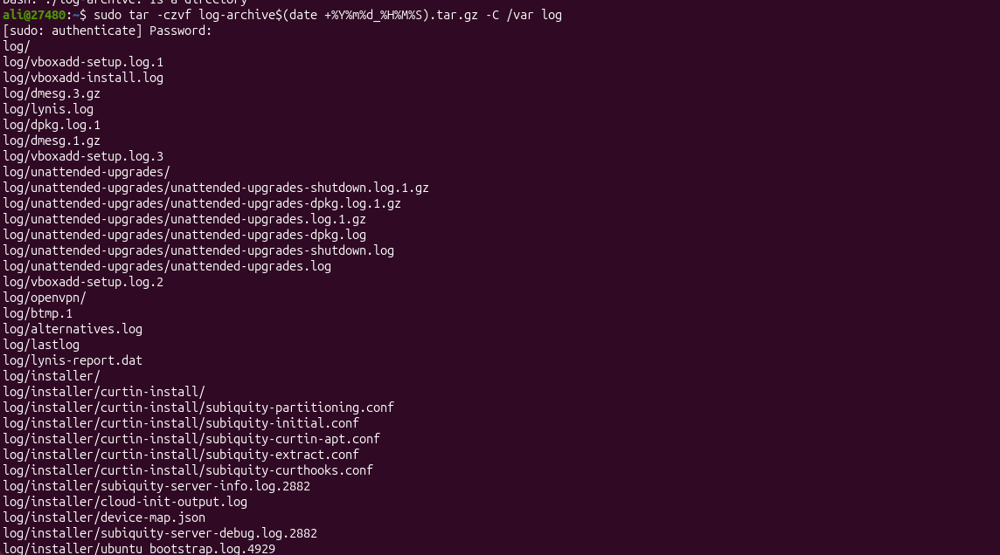
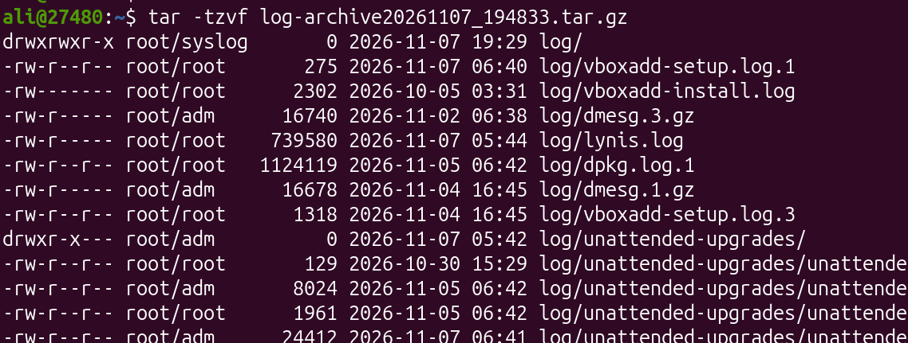

# Log Archive Tool

## 1. Project Description

The Log Archive Tool is a simple Bash script that helps users archive system log files from the Linux command line.

It takes a log directory as an argument, checks whether the directory exists, compresses the logs into a `.tar.gz` archive, and stores the archive in a separate directory.

It also records the date and time of each archive operation in a log file.

This project helps keep the system clean while preserving old logs for future reference.

## 2. Project Objectives

- Learn how to create Bash scripts.
- Practice working with files and directories.
- Learn how to use command-line arguments.
- Understand TAR and gzip compression.
- Automate log archiving.
- Learn how to record dates and times in a log file.

## 3. Technologies Used

- **Operating System:** Ubuntu Linux
- **Language:** Bash Scripting
- **Commands:** `tar`, `date`, `mkdir`, `if`, `echo`
- **Archive Format:** `.tar.gz`

## 4. Project Structure

```text
log-archiver/
│
├── log-archive
│
├── README.md
│
└── screenshots/
    ├── 01-project-structure.png
    ├── 02-script-execution.png
    ├── 03-archive-created.png
    ├── 04-archive-contents.png
    └── 05-archive-log.png
```

## 5. How the Tool Works

1. The user provides a log directory as an argument.
2. The script checks whether the correct argument was provided.
3. It checks whether the log directory exists.
4. It creates a directory called `~/log-archives` if it does not already exist.
5. It compresses the logs into a `.tar.gz` archive.
6. It adds the date and time to the archive filename.
7. It records the archive date and time in `archive.log`.

Example archive filename:

```text
logs_archive_20240816_100648.tar.gz
```

## 6. Requirements

Before running the tool, make sure you have:

- Ubuntu Linux.
- Bash shell.
- TAR utility.
- A directory containing log files.

## 7. Installation and Setup

Clone or download this project to your Ubuntu machine.

Navigate to the project directory:

```bash
log-archive$(date +%Y%m%d_%H%M%S).tar.gz
```

Give the script execution permission:

```bash
chmod +x log-archive
```


### Example

To archive the system logs in `/var/log`, execute:

```bash
sudo tar -czvf log-archive$(date +%Y%m%d_%H%M%S).tar.gz -C /var log
```

The script will process the directory and create a compressed archive.




## 9. Archive Storage

The compressed archives are stored in:

```bash
log-archive20261107_194833.tar.gz.
```

To view the archive files:

```bash
ls -lh log-archive20261107_194833.tar.gz
```

Example output:

```text
logs_archive_20240816_100648.tar.gz
```


## 10. Verify the Archive

To check the contents of the archive, use:

```bash
tar -tzvf log-archive20261107_194833.tar.gz
```

This command lists the files stored inside the archive without extracting them.




## 11. Archive History

The tool records the date and time of archive operations in:

```bash
~/log-archives/archive.log
```

To view the archive history:

```bash
cat log-archive20261107_194833.tar.gz
```


## 12. Error Handling

The script checks for common errors, including:

- No directory argument provided.
- Incorrect number of arguments.
- The specified log directory does not exist.

## 13. What I Learned

Through this project, I practiced:

- Writing Bash scripts.
- Using command-line arguments.
- Checking directories using conditional statements.
- Creating directories automatically.
- Compressing files using TAR and gzip.
- Generating timestamps using the `date` command.
- Recording information in log files.
- Working with Linux file permissions.

## 14. Future Improvements

Possible improvements include:

- Automatically archiving logs on a schedule using cron.
- Sending archive notifications through email.
- Uploading archives to remote servers.
- Storing archives in cloud storage.
- Automatically deleting old archives after a specified period.

## 15. Conclusion

The Log Archive Tool is a simple Linux automation project that helps users compress and preserve log files.

It demonstrates practical Bash scripting skills and introduces important Linux commands for managing files, directories, and archives.
